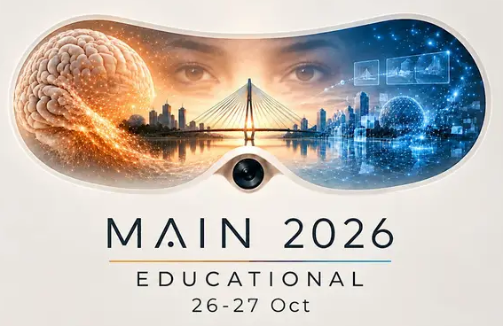
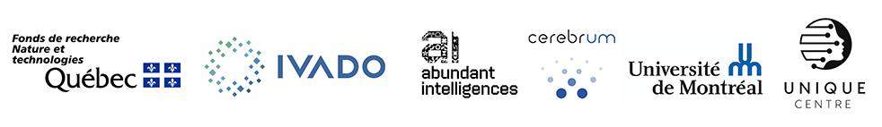

# Registration is open

:::{important}
**MAIN educational 2026 will be held on October 26th-27th 2026, at the CRIUGM in Montréal.**

👉 **[Register on Eventbrite](https://www.eventbrite.ca/e/main-educational-2026-tickets-1999327932667)** (registration for MAIN educational only).
:::

MAIN (Montreal AI & Neuroscience) is organized by the [UNIQUE](https://www.unique.quebec/) NeuroAI center (Unifying Neuroscience and Artificial Intelligence - Québec), directed by Karim Jerbi. MAIN educational is its training program: two days dedicated to learning and sharing methods in NeuroAI. This edition is hosted by the Centre de recherche de l'Institut universitaire de gériatrie de Montréal ([CRIUGM](venue)), and led by Lune Bellec, researcher at the CRIUGM and full professor at the Department of psychology, Université de Montréal, who sits on the MAIN executive committee and chairs the MAIN educational committee. This is an in person event.

The [program](program) features lectures and hands-on tutorials on current developments in NeuroAI, with a focus on training the next generation of researchers and helping them adopt the methods and tools of the field. Day one focuses on reasoning about the world (world models and embodied agents), and day two on benchmarking the alignment between brains, behaviour and AI models.

**Open science:** by encouraging the discussion and reuse of research methods and tools, MAIN educational contributes to more open and reproducible scientific practices.

The MAIN 2026 conference itself will follow on October 29th-30th 2026, at HEC Montréal (separate registration).

